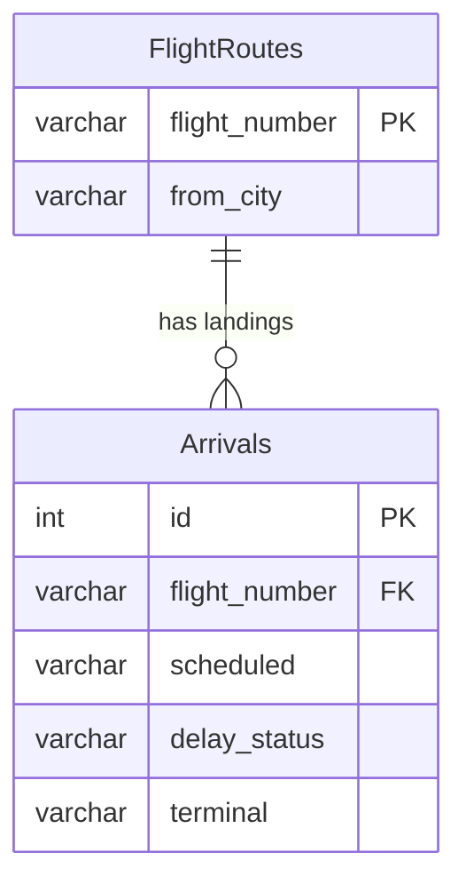

# Flight Arrivals Management System (`JDBC_FlightManager`)

**Course:** Software Engineering Methods (2026–2027)  
**Institution:** Braude College of Engineering | Department of Software Engineering  
**Database:** MySQL 8.0+ | **Language:** Java 25 (JDBC)

## 1. Project Description

JDBC_FlightManager uses flight-arrival data from `arrived_flights.csv` and stores route and arrival information in two related MySQL tables. `FlightManagerBase` and `FlightViewer` display arrivals together with their origin cities. `SimpleFlightUpdater` updates the delay status of flight LX354. `AdvancedFlightDispatcher` uses a prepared statement to update arrival records by ID.

## 2. Engineering Team Details (Single-Workstation Driver-Navigator)

| Role | Full Name | Student ID | Braude Academic Email |
| :--- | :--- | :--- | :--- |
| Student A | [Seren Amoun] | [215081084] | [Seren.Amoun@braude.ac.il] |
| Student B | [Mayar Serhan] | [325475440] | [Mayar.Serhan@braude.ac.il] |

- **Group Number:** [20/9]
- **GitHub Repository URL:** [JDBC_FlightManager](https://github.com/Am-Sireen/JDBC_FlightManager)

## 3. Technology Stack

- BellSoft Liberica Full JDK 25 and JDBC
- MySQL Server 8.0+ and MySQL Connector/J 9.5.0
- IntelliJ IDEA and its Database tools
- Continue and LM Studio with Qwen2.5-Coder-7B-Instruct
- Git and GitHub

## 4. Database Normalization (3NF) & Functional Dependencies (F)

The source relation is `rawflights(scheduled, flight, fromC, delay, terminal)`. The project assumes that a flight number identifies its origin city, so `flight → fromC`. After assigning each arrival a unique `id`, the arrival key determines its flight number, scheduled time, delay status and terminal. Arrival IDs identify events, so one flight number can have multiple arrival records in the relational schema.

Storing the origin city in each arrival record would repeat the same route information. A route change would require updating every matching arrival, a route could not be recorded without an arrival, and deleting the last arrival could remove the route information. The schema stores the origin city once per flight number and uses a foreign key to associate arrivals with the route.

- `FlightRoutes(flight_number PK, from_city)`
- `Arrivals(id PK, flight_number FK, scheduled, delay_status, terminal)`
- `Arrivals.flight_number` references `FlightRoutes.flight_number` with `ON DELETE CASCADE`.

## 5. Independent AI Prompt (Part 4 - FlightViewer.java)

```text
Replace the entire selected content of FlightViewer.java with a complete Java class named FlightViewer. Include the imports and a main method. Leave the other project files unchanged.

Connect to the local MySQL database FlightDB using the same JDBC connection settings as FlightManagerBase.java. Ask the user for the MySQL root password using Scanner. Ask for a terminal number and accept only 2, 3, 4, or 5. Use try-with-resources for the Scanner, Connection, PreparedStatement, and ResultSet.

Run a SELECT with an INNER JOIN between arrivals and flightroutes on flight_number. Filter by arrivals.terminal = ? and bind the selected terminal with setString(1, terminal), because terminal is stored as VARCHAR. Sort the results by arrivals.scheduled ASC.

Print the arrival ID, flight number, departure city, scheduled time, delay status, and terminal in a readable table. If there are no matching arrivals, print a clear message
```
## 6. Entity Relationship Diagram (ERD)



## 7. Security Audit Summary (Part 5 - SQL Injection Mitigation)

The original update assembled SQL by concatenating user input into the statement, allowing untrusted input to change the structure of the SQL and defeat the intended row filter. The expected lab scenario illustrates how a single-flight update can affect the entire arrivals table.

The current `SimpleFlightUpdater` uses `PreparedStatement` and binds the delay status and flight number as separate parameters. The status remains data and the SQL statement retains its flight-number filter. A normal update can be checked by comparing the target arrival and another arrival before and after the update.

## 8. License

Distributed under the **Braude College Academic License** (Software Engineering Methods, 2026–2027).

